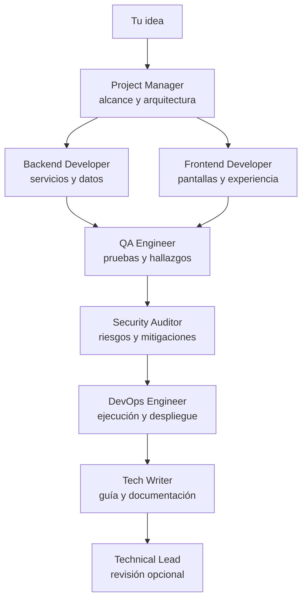

<div align="center">
  
  <h1>Ckrafter</h1>
  <p><strong>Un equipo de agentes de IA convierte tu idea en un plan técnico y una primera propuesta de proyecto.</strong></p>
  <p>
    <a href="https://github.com/ckro0/ckrafter"></a>
    <a href="https://github.com/ckro0/ckrafter"></a>
    <a href="https://github.com/ckro0/ckrafter"></a>
    <a href="https://github.com/ckro0/ckrafter"></a>
  </p>
  <p><a href="#inicio-rápido">Empezar</a> · <a href="#qué-hace">Qué hace</a> · <a href="#privacidad-y-costos">Privacidad y costos</a> · <a href="#contribuir">Contribuir</a></p>
</div>

---

## ¿Qué es Ckrafter?

Ckrafter organiza el trabajo inicial de un proyecto de software como lo haría un pequeño equipo: separa la idea en áreas especializadas, pasa el contexto entre ellas y guarda los resultados para que puedas revisarlos y continuar.

Puedes usar una **app web local** con progreso visible y un mapa interactivo, o seguir trabajando desde la **consola**. La interfaz no te obliga a elegir Python ni un stack fijo: los agentes deben respetar las tecnologías que pidas y justificar las que recomienden.

> **Importante:** Ckrafter prepara documentación, decisiones técnicas y ejemplos de código. No publica, despliega ni entrega por sí solo una aplicación terminada lista para producción.

## Qué hace

- **Planifica el proyecto:** define alcance, arquitectura, stack, tareas y riesgos.
- **Desarrolla en paralelo:** los agentes de backend e interfaz preparan propuestas coordinadas.
- **Revisa el resultado:** QA, seguridad, DevOps y documentación completan la primera entrega.
- **Hace visible el progreso:** la app web muestra las etapas y un globo ASCII animado mientras el equipo trabaja.
- **Permite explorar el resultado:** abre los documentos desde la app y selecciona una etapa para preparar una revisión enfocada.
- **Conserva el avance:** las sesiones se guardan localmente y pueden reanudarse desde la consola.
- **Admite distintos stacks:** Java, Kotlin, C#, Go, Rust, Python, JavaScript/TypeScript y otras opciones según el proyecto.

## El recorrido



La revisión del Technical Lead se puede solicitar al elegir una zona del diagrama; no es una etapa automática del recorrido inicial.

## Entregables

Los resultados se guardan como Markdown en `output/<id-de-sesion>/`. Incluyen propuestas y bloques de código para adaptar al proyecto:

| Archivo | Enfoque |
| --- | --- |
| `01_plan_tecnico.md` | Alcance, arquitectura, stack y tareas |
| `02_backend_code.md` | Propuesta del backend y sus componentes |
| `03_frontend_code.md` | Propuesta de interfaz y experiencia |
| `04_qa_report.md` | Casos de prueba y revisión de calidad |
| `05_security_report.md` | Riesgos y recomendaciones de seguridad |
| `06_devops_config.md` | Ejecución, infraestructura y despliegue |
| `07_documentation.md` | Guía de uso y documentación |
| `00_lead_review.md` | Revisión enfocada opcional |

## Inicio rápido

### Windows: app web local

**Necesitas:** Python 3.11 o posterior y una cuenta o instalación de un proveedor compatible.

1. Descarga o clona este repositorio.
2. Ejecuta `iniciar.bat`.
3. En la primera ejecución se prepara el entorno; después se abre la app en el navegador.
4. En **Configuración**, selecciona Groq, OpenAI u Ollama y añade la clave cuando corresponda.
5. Describe tu proyecto y sigue el avance en el mapa del equipo.

La aplicación escucha solo en `127.0.0.1`; no está pensada para publicarse como servidor accesible desde Internet.

### Instalación manual

Desde la carpeta del repositorio, en PowerShell:

```powershell
py -3 -m venv .venv
.\.venv\Scripts\python.exe -m pip install --upgrade pip
.\.venv\Scripts\python.exe -m pip install -e .
.\.venv\Scripts\python.exe -m src.interfaces.web
```

Para abrir la alternativa de consola:

```powershell
.\.venv\Scripts\python.exe main.py
```

La app web no necesita Node.js ni un framework frontend que instalar: sus recursos se sirven desde el propio proyecto.

### Proveedores de IA

La app permite configurar el proveedor desde su interfaz:

| Proveedor | Requisito |
| --- | --- |
| **Groq** | Clave de API y conexión a Internet |
| **OpenAI** | Clave de API y conexión a Internet |
| **Ollama** | Ollama instalado, en ejecución y con el modelo elegido disponible localmente |

La disponibilidad, límites y posibles costos dependen del proveedor y de tu cuenta. Para usar Ollama, instala y descarga previamente un modelo compatible, por ejemplo `ollama pull llama3.2`.

## Consola y otras plataformas

La consola sigue disponible y es la opción adecuada para Termux u otros entornos donde no se quiera usar la app web.

```bash
python main.py --req "Una API en Java para gestionar reservas de un hotel" --lang espanol
```

Opciones útiles:

```text
--req       Descripción del proyecto
--lang      Idioma de los entregables: espanol | english
--provider  Proveedor: groq | openai | ollama
--low-cost  Solicita la configuración de menor costo disponible
--usage     Muestra la guía de uso
```

En Android, puedes probarlo desde Termux o Pydroid con Python 3.11+ y las dependencias del proyecto. La compatibilidad concreta también depende de las dependencias del proveedor de IA y del entorno disponible.

## Privacidad y costos

- La interfaz local enlaza únicamente a `127.0.0.1`.
- La clave se guarda en el archivo `.env` del proyecto; ese archivo está excluido de Git. **No compartas ni publiques tus claves.**
- Los requerimientos y el contexto que necesitan los agentes se envían al proveedor de IA que configures. Si usas Groq u OpenAI, se procesan mediante sus servicios; si usas Ollama, el procesamiento puede ser local según tu configuración.
- Consulta las políticas, condiciones, límites y tarifas actuales del proveedor que elijas. Ckrafter no controla esos términos.
- Los documentos generados se guardan en tu equipo. Revisa el código y las recomendaciones antes de usarlos: son material de partida, no una auditoría ni una garantía de seguridad.

## Aplicación adicional: FixFinder

Este repositorio incluye también **FixFinder**, una pequeña app web local para buscar guías públicas de reparación de iFixit por dispositivo.

```powershell
py -3 repair_finder\server.py
```

Después abre <http://127.0.0.1:8765>. FixFinder necesita conexión a Internet para consultar iFixit; las guías y sus derechos pertenecen a sus autores y se abren en el sitio original. Esta herramienta es independiente del flujo de generación de proyectos de Ckrafter.

## Ejecutar las pruebas

Con las dependencias del proyecto instaladas:

```powershell
.\.venv\Scripts\python.exe -m unittest discover -s tests
```

También puedes validar la sintaxis de la interfaz web con Node.js, si lo tienes instalado:

```powershell
node --check src\interfaces\web_static\app.js
```

## Estructura del repositorio

```text
src/
  agents/team.py             Instrucciones y configuración de los agentes
  crews/dev_crew.py           Flujo de trabajo y generación de entregables
  interfaces/
    cli.py                    Interfaz de consola
    web.py                    Servidor local y API de la app web
    web_static/               Interfaz web, estilos y comportamiento
  sessions/manager.py         Persistencia y reanudación de sesiones
repair_finder/                App independiente de búsqueda de guías
tests/                        Pruebas automatizadas
output/                       Entregables generados localmente
sessions/                     Sesiones guardadas localmente
```

## Contribuir

Las mejoras, reportes de errores y propuestas son bienvenidos. Antes de abrir un issue, describe los pasos para reproducir el problema, el comportamiento esperado y el entorno (sistema operativo, versión de Python y proveedor, sin incluir claves ni datos privados).

Para proponer cambios:

1. Crea una rama para tu cambio.
2. Mantén el alcance enfocado y añade pruebas cuando cambie el comportamiento.
3. Ejecuta `python -m unittest discover -s tests` y `git diff --check`.
4. Abre un pull request explicando el problema, la solución y cómo la verificaste.

## Aviso

Las respuestas de los modelos pueden contener errores, omisiones o recomendaciones inseguras. Valida las decisiones, ejecuta las pruebas apropiadas y realiza una revisión de seguridad antes de usar código generado en producción.
